# Graphics study: the DevOps page

Structure first, colour last. Captured 2026-11-22 in a headless browser, except the Kubernetes Dashboard and the two k9s screens, which come from the projects' own repositories.

## Consoles

<figure>
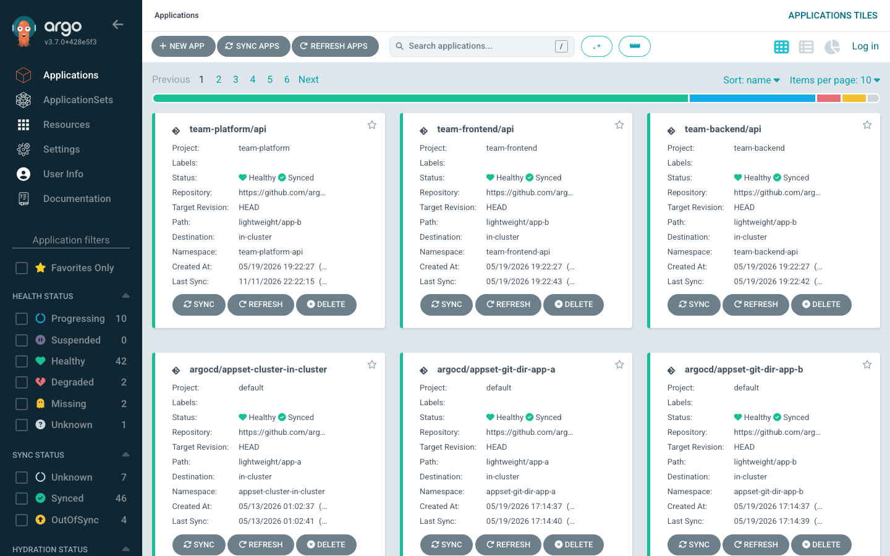
<figcaption>Argo CD, list. Filters with counts on the left, one stacked bar of the totals, tiles with a coloured edge.</figcaption>
</figure>

<figure>
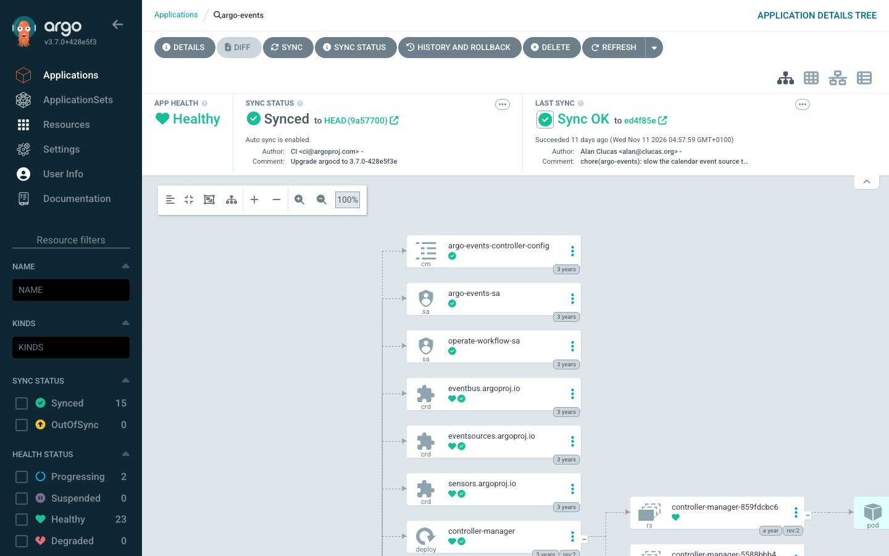
<figcaption>Argo CD, tree. A graph of what owns what, a kind icon on every node, health and sync as big words on top.</figcaption>
</figure>

<figure>
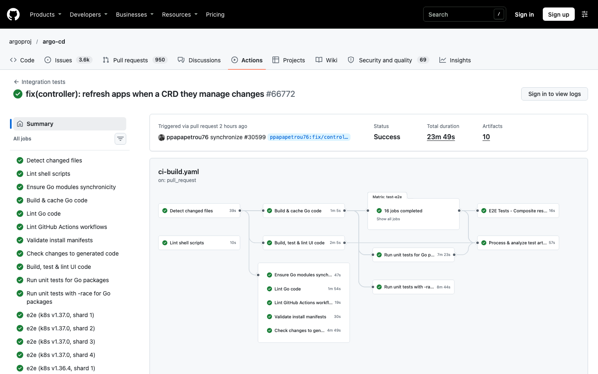
<figcaption>GitHub Actions. Jobs as boxes with their duration, joined left to right; a matrix folded into one box.</figcaption>
</figure>

<figure>
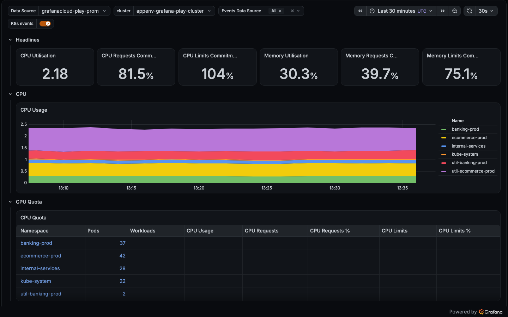
<figcaption>Grafana. Big numerals, one chart, one table; time range and refresh on top.</figcaption>
</figure>

<figure>
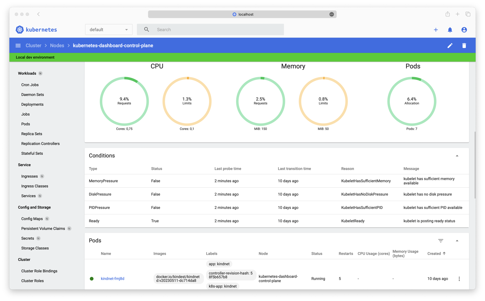
<figcaption>Kubernetes Dashboard. Blue title bar with breadcrumb, a menu of resource kinds, ring gauges for CPU, memory and pods, plain tables.</figcaption>
</figure>

## Retro

<figure>
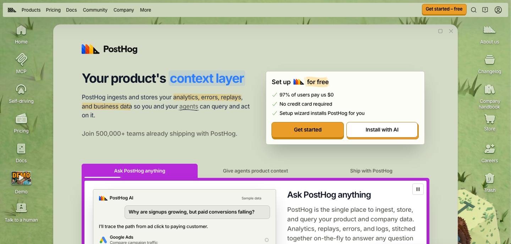
<figcaption>PostHog. The whole site is a desktop: icons down both sides, a menu bar on top, the page is a window with maximise and close.</figcaption>
</figure>

<figure>
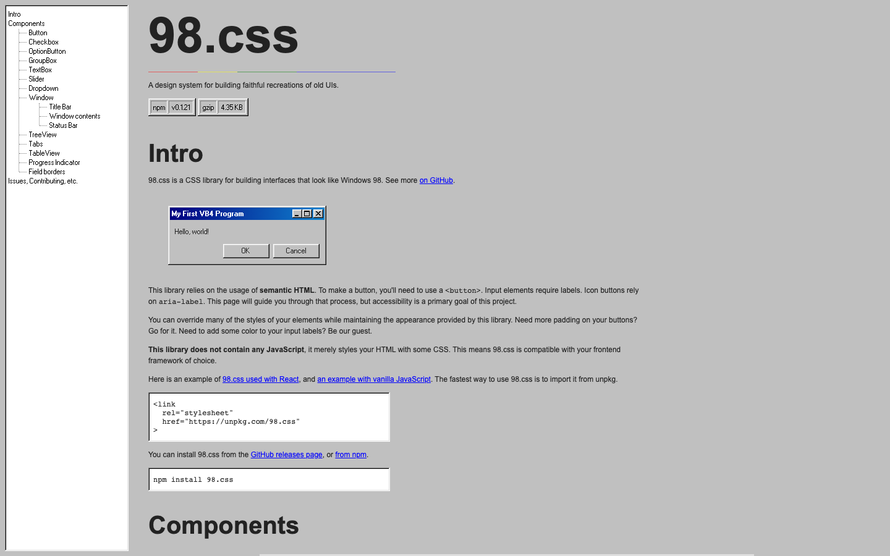
<figcaption>98.css, a CSS library for Windows 98: grey bevelled buttons, blue title bars, tree view, tabs. No JavaScript.</figcaption>
</figure>

## Command line

<figure>
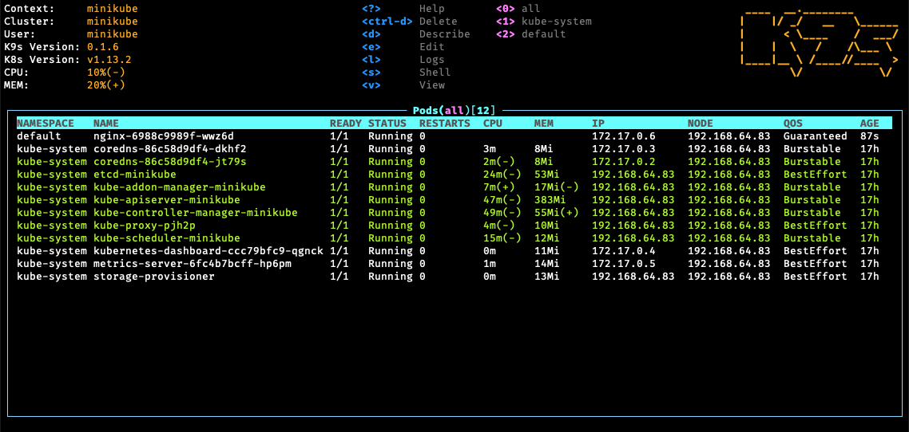
<figcaption>k9s. Key hints in the header, one table, colour only for state: green for running, cyan for the selection.</figcaption>
</figure>

<figure>
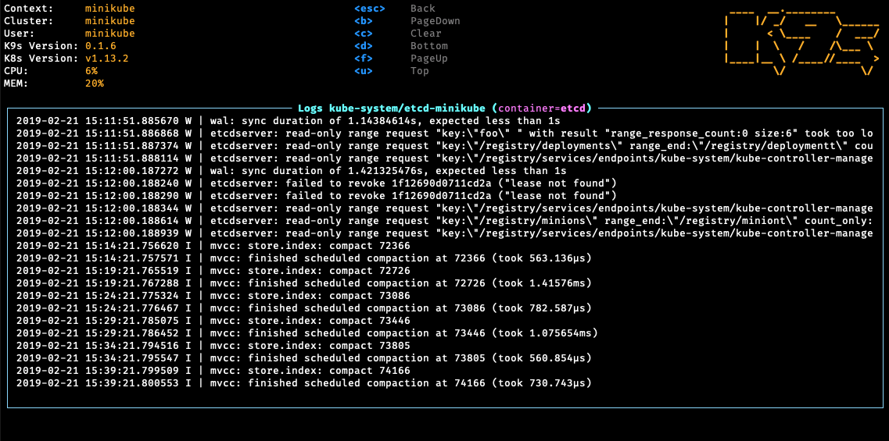
<figcaption>k9s again, streaming logs in a framed pane.</figcaption>
</figure>

## Ours today

<figure>
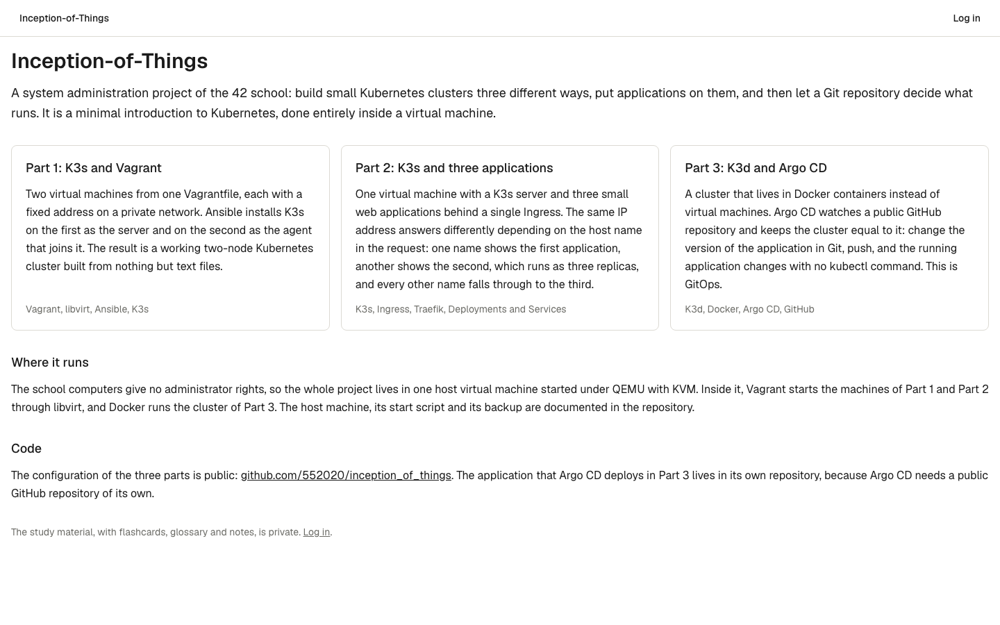
<figcaption>The public page: three paragraphs about machines and connections.</figcaption>
</figure>

<figure>
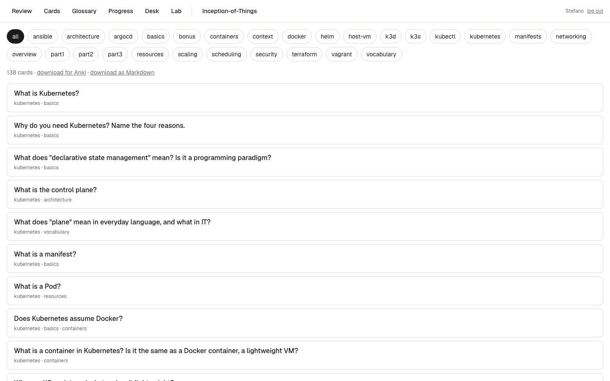
<figcaption>The cards list: 138 equal boxes, no state, no counts on the tags.</figcaption>
</figure>

## Directions

Settled by you: the style is about the whole site, not the desk or the phone, and the public page shows off, with diagrams in it.

- A. Console: sidebar with filters and counts, a totals bar, rows with the state first.
- B. Topology: the public page drawn as diagrams, with real addresses, routes and a Git loop.
- C. Pipeline: the three parts as stages with progress numbers.
- D. Panels: Progress as a dashboard of big numerals and charts.
- E. Command line: one monospace screen, key hints in the header, framed panes, state-only colour.
- F. Retro desktop: grey bevelled windows with title bars, icons on a desktop, a taskbar. Diagrams sit well in a window.

E and F are style, A to D are structure; one of each kind combines.

## Sources

Argo CD demo https://cd.apps.argoproj.io · GitHub Actions run https://github.com/argoproj/argo-cd/actions/runs/45018135303 · Grafana playground https://play.grafana.org · Kubernetes Dashboard https://github.com/kubernetes/dashboard · k9s https://github.com/derailed/k9s · PostHog https://posthog.com · 98.css https://jdan.github.io/98.css/
