# Logo study

Starting from the Kubernetes marks: what a mark in this family does, and nine sketches for ours. The sketches are drawn by hand in this study with original geometry. **Chosen: G** (2026-11-22), the eye with the wheel. It is in the header of both styles, as the favicon and large beside the title of the public page.

## The family

<figure>
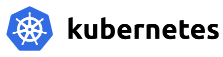
<figcaption>Kubernetes, horizontal: a ship's wheel in a heptagon, the name in lower case beside it. One blue, #326CE5 (Pantone 285C).</figcaption>
</figure>

<figure>
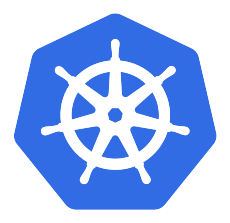
<figcaption>The icon alone, the version used as a favicon. The same drawing exists in colour, black and white, as icon, horizontal and stacked.</figcaption>
</figure>

<figure>
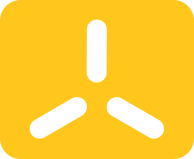
<figcaption>K3s: a yellow rounded square with three spokes. The wheel reduced to its minimum.</figcaption>
</figure>

<figure>
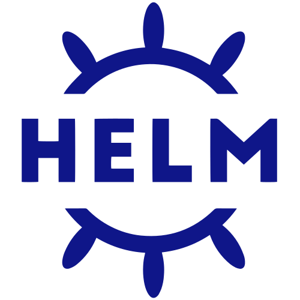
<figcaption>Helm: the name inside the handles of a wheel.</figcaption>
</figure>

<figure>
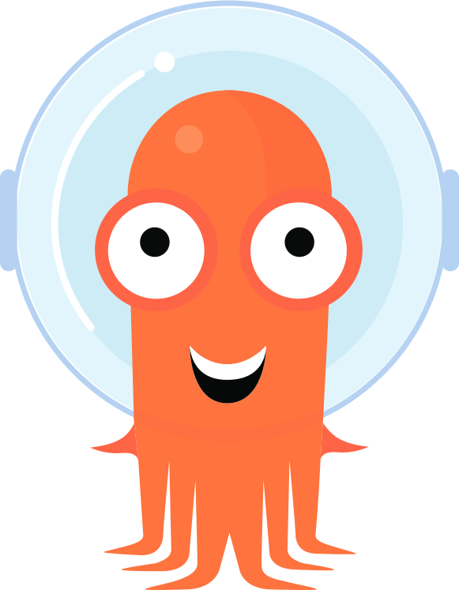
<figcaption>Argo: not geometric, a mascot, an octopus in a helmet.</figcaption>
</figure>

## What the marks share

- One colour plus white, readable as a silhouette at 16 pixels.
- A circle or a regular polygon as the base, thick even strokes, rounded ends.
- The name beside the mark in a plain lower-case sans.
- Three layouts: the icon alone (favicon), horizontal (header), stacked.

Kubernetes' own guidelines allow changing the mark for non-commercial uses such as stickers, and ask that a use never implies endorsement by the Linux Foundation. So ours must not be the heptagon with the helm, and must not be mistaken for it. Kubernetes comes from the Greek word for helmsman, which is why the mark is a wheel.

## Sketches

Each sheet shows the mark large and at 64, 32, 16 and 20 pixels, on light and on dark.

<figure>
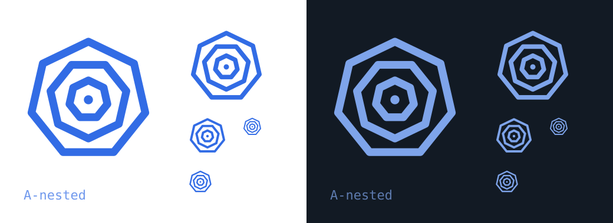
<figcaption>A. Nested. Heptagon inside heptagon inside heptagon: Inception, a machine in a machine in a cluster. Keeps the seven sides, so the family link is clear, and the risk of resembling Kubernetes is the highest after B.</figcaption>
</figure>

<figure>
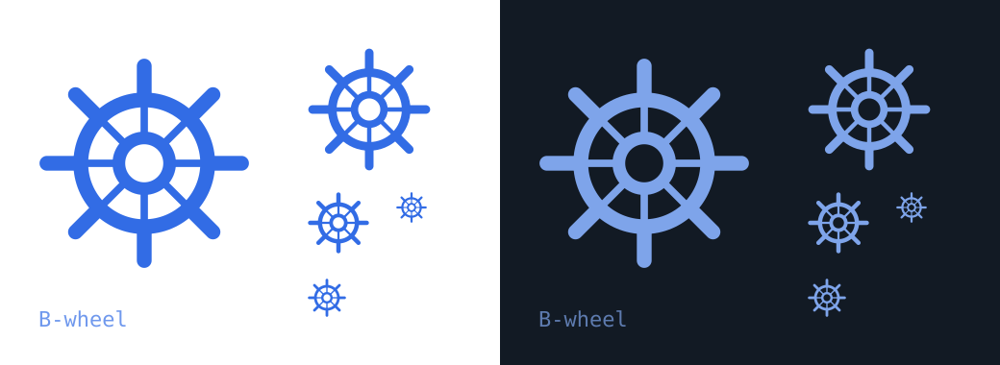
<figcaption>B. Wheel. A ring inside a ring with eight handles. A generic ship's wheel, and for that reason the closest to the Kubernetes helm. Shown to compare, not to choose.</figcaption>
</figure>

<figure>
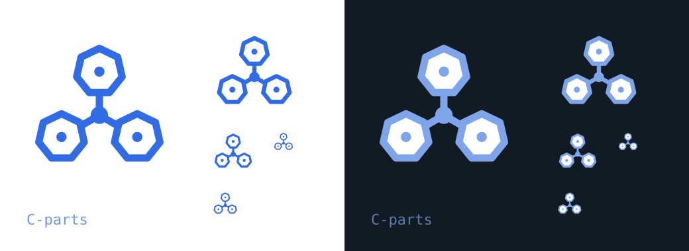
<figcaption>C. Three parts. Three small heptagons joined to a hub: p1, p2, p3.</figcaption>
</figure>

<figure>
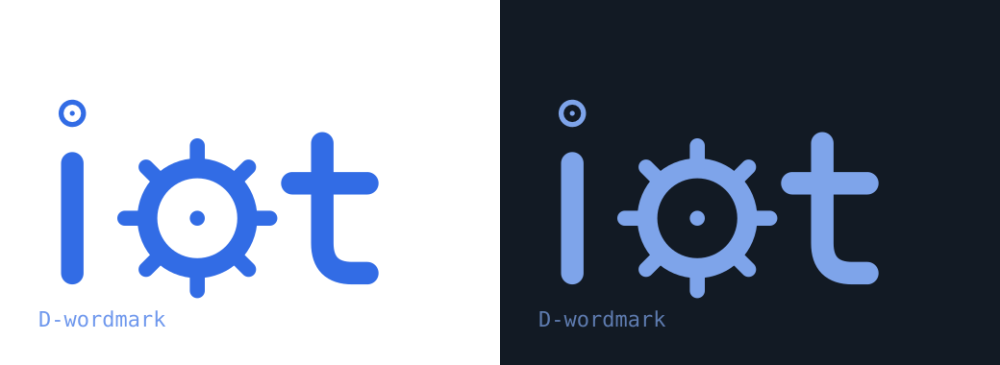
<figcaption>D. Wordmark. iot in lower case like the Kubernetes name, the o a wheel with handles. Works as the header logo.</figcaption>
</figure>

<figure>
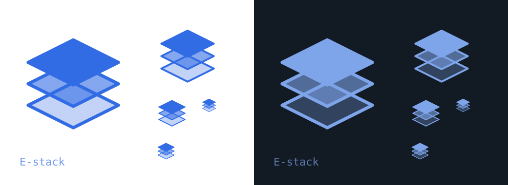
<figcaption>E. Stack. Three layers: the host machine, the virtual machines, the cluster. Furthest from Kubernetes, and the clearest picture of Inception.</figcaption>
</figure>

<figure>
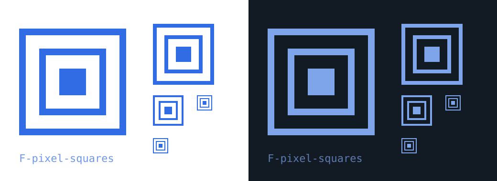
<figcaption>F. Pixel squares. Three squares in squares on a 16 by 16 grid, the Inception idea in the 98 style: title bar, favicon, desktop icon.</figcaption>
</figure>

<figure>

<figcaption>G. Eye with a wheel. An eye whose pupil is a small wheel with eight handles: the cluster that watches, and the third eye of the setup. The k9s mascot already puts the Kubernetes wheel into the lenses of its glasses, so the joke is known in this family.</figcaption>
</figure>

<figure>
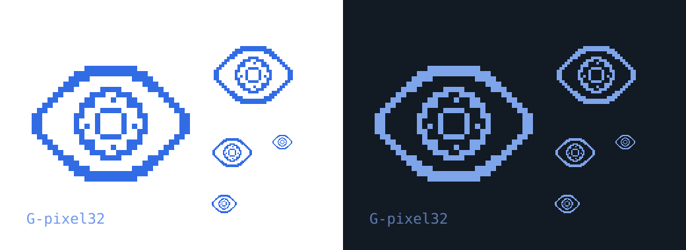
<figcaption>G in the 98 style. On a 32 by 32 grid the pupil keeps its ring and eight single-pixel handles. At 16 pixels the wheel is too fine and G collapses to the eye with a plain pupil, as in I.</figcaption>
</figure>

<figure>
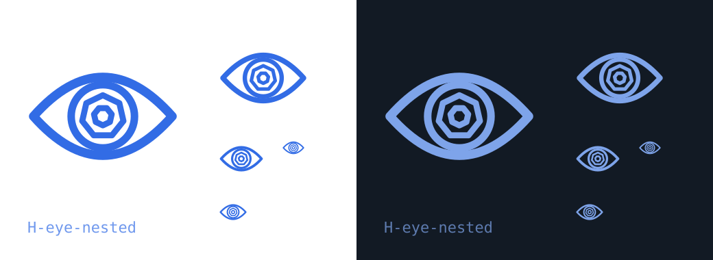
<figcaption>H. Eye with nested heptagons. The same eye with the layers of A as the pupil: an eye that looks into a machine in a machine.</figcaption>
</figure>

<figure>
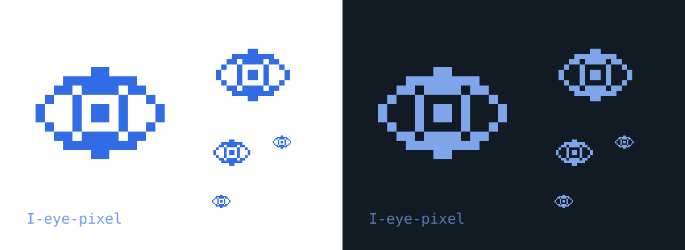
<figcaption>I. Pixel eye. The eye on a 16 by 16 grid, for the 98 style.</figcaption>
</figure>

## Per skin

The logo lives in the title bar of the window and in the favicon. On the desktop skin it is the rounded colour mark, on the 98 skin the pixel one. F and I are pixel forms; whichever mark is chosen needs both.

Dropped: a pixel wheel with four spokes inside a ring. It reads as a sun cross or Celtic cross, a symbol used by neo-Nazis, and has no place on this site. Rule for the rest: no cross inside a circle, and no four-armed shape.

## Sources

Kubernetes, K3s, Argo and Helm artwork from https://github.com/cncf/artwork · Kubernetes colours and usage guidelines https://github.com/kubernetes/kubernetes/tree/master/logo
