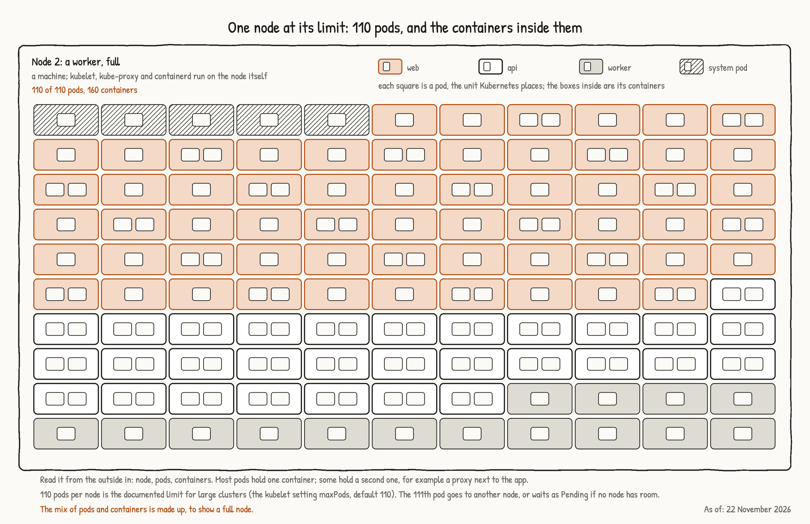
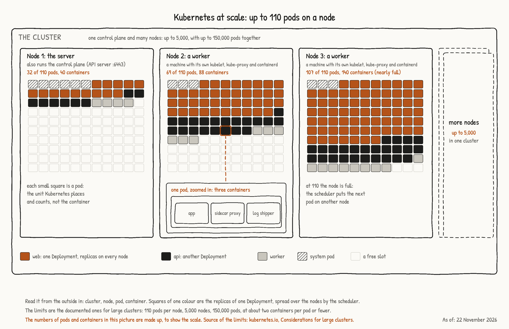
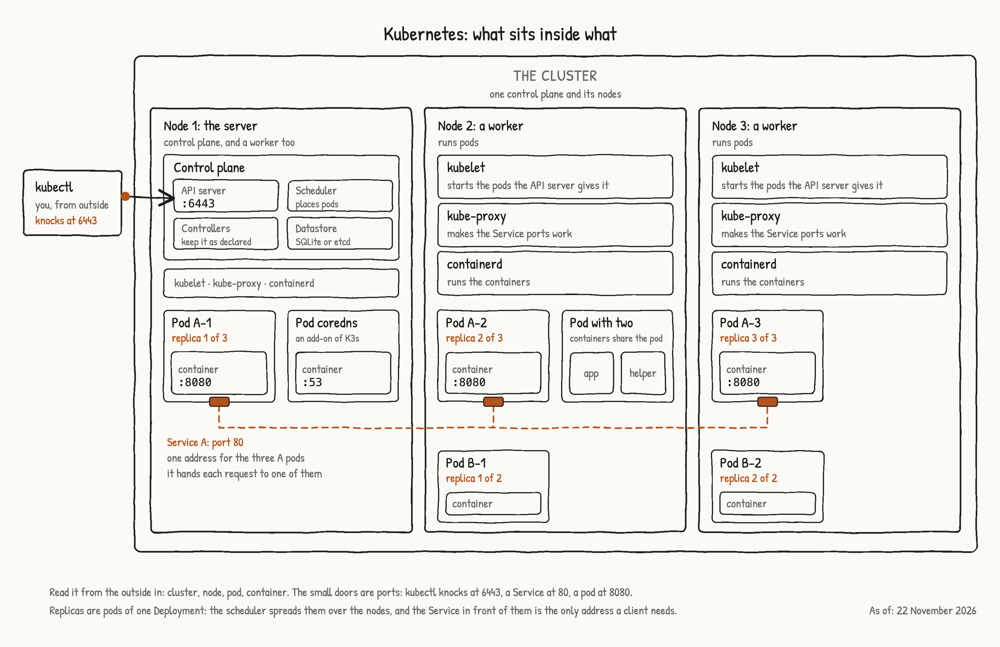
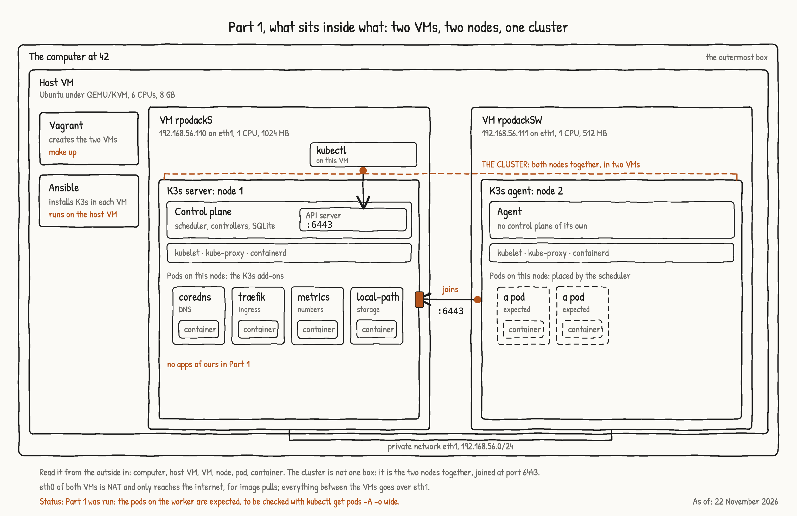
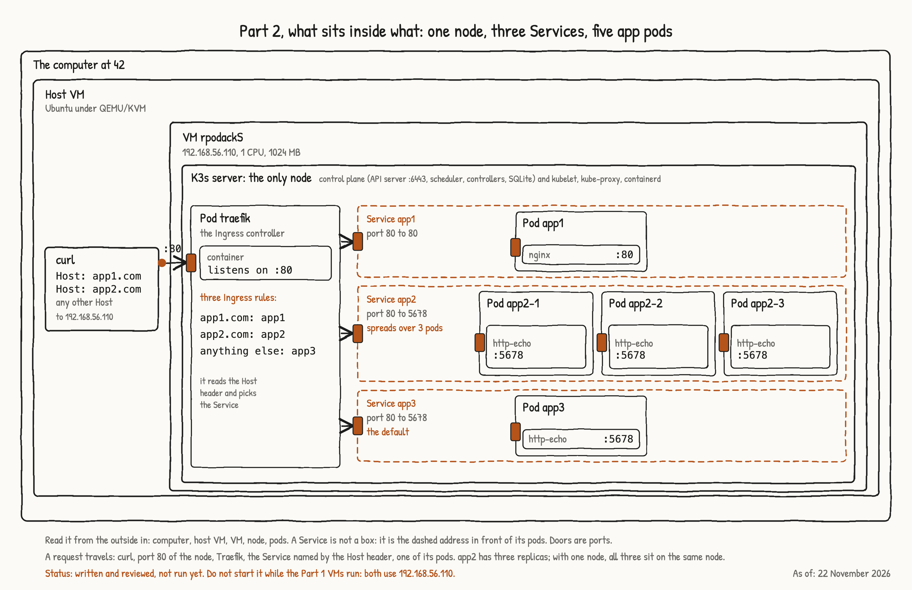
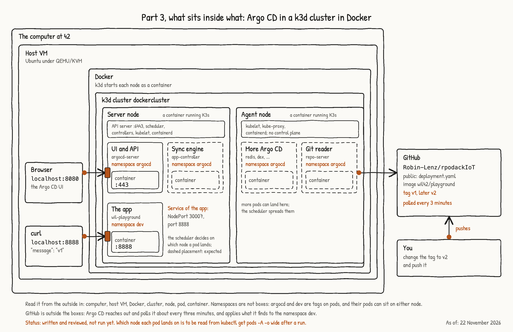

# Nesting sketches

Kubernetes drawn as nested boxes: what sits inside what, with the ports as small doors and a Service as the dashed address in front of its pods. Read each picture from the outside in. In the general picture the cluster holds three nodes, a node holds pods, a pod holds containers, and the replicas of one Deployment sit on different nodes behind one Service. The control plane, with the API server on port 6443, lives in the server node.

The limits in the scale pictures are the documented ones for large clusters (kubernetes.io, Considerations for large clusters): 110 pods per node, 5,000 nodes, 150,000 pods in a cluster, at about two containers per pod or fewer. The numbers of pods in the pictures are made up. The pictures for the parts use the real names and ports of the project. Part 1 was run; Part 2 and 3 are drawn from the files and the subject. The pods that K3s and Argo CD start by themselves, and the node each pod lands on, are expected, not counted: they are to be read from `kubectl get pods -A -o wide` after a run.

## To understand Kubernetes

These two do not belong to a part of the project. They show what Kubernetes is when it runs a real app.

<figure>

<figcaption>One node at its limit: 110 pods, and the containers inside them. A pod is the unit Kubernetes places; most hold one container, some two. The 111th pod goes to another node, or waits as Pending if no node has room.</figcaption>
</figure>

<figure>

<figcaption>Kubernetes at scale: many nodes, each with up to 110 pods, and the replicas of one Deployment, the squares of one colour, spread over the nodes. One pod is zoomed in to show its containers.</figcaption>
</figure>

## The cluster and the three parts

<figure>

<figcaption>The general picture: one cluster, three nodes, the control plane in the server node, replicas spread over the nodes, the Service in front of them.</figcaption>
</figure>

<figure>

<figcaption>Part 1: the computer, the host VM, two VMs, one K3s node in each; the cluster is both nodes together, joined at port 6443.</figcaption>
</figure>

<figure>

<figcaption>Part 2: one VM with one node; port 80 reaches Traefik, which picks one of three Services; app2 has three replica pods.</figcaption>
</figure>

<figure>

<figcaption>Part 3: Docker, the k3d cluster, two node containers, the pods of Argo CD and of the app; GitHub outside.</figcaption>
</figure>

