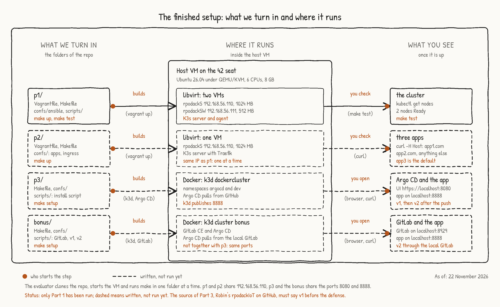
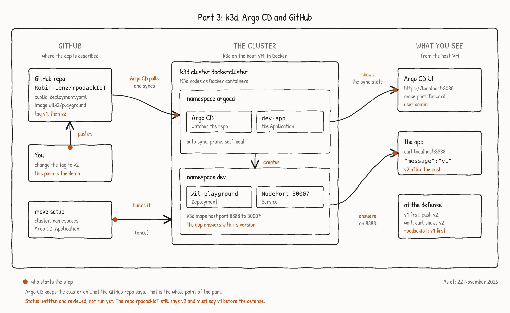
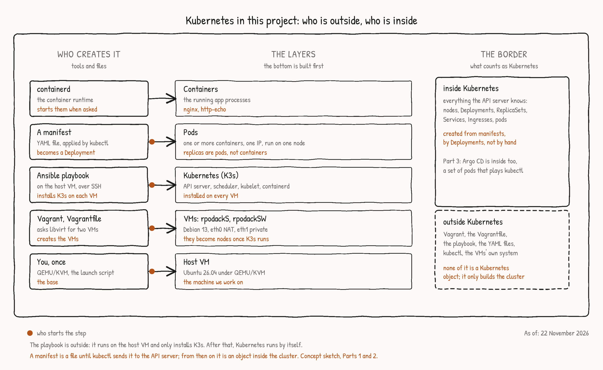

# Sketches

The hand-drawn sketches of the project, as they are in the repository (`docs/diagrams` on the branch `host-vm-kvm`, pull request 6). The three final-state sketches are also on the public pages of the parts. State of the drawings: 22 November 2026. A dot marks who opens a connection or starts a step; dashed means written but not run yet. Only Part 1 has been run.

## Final state of each part

<figure>

<figcaption>Part 1 running: the K3s server and the K3s agent in their two VMs, kubectl as the client, the join over port 6443, the pod network on eth1.</figcaption>
</figure>

<figure>

<figcaption>Part 2 running: curl with a Host header, Traefik on port 80, three Services, the pods behind them.</figcaption>
</figure>

<figure>

<figcaption>Part 3 running: Argo CD polling the GitHub repository and keeping the namespace dev equal to it, the app on port 8888, the interface on 8080.</figcaption>
</figure>

<figure>

<figcaption>The finished setup: the four folders that are turned in, where each runs inside the host VM, and what you see once it is up.</figcaption>
</figure>

## Overview of each part

<figure>

<figcaption>Part 1: the host VM, the steps of make up, the two VMs, the known stall of make provision.</figcaption>
</figure>

<figure>

<figcaption>Part 2: the Host header, Traefik, three apps, app3 as the default.</figcaption>
</figure>

<figure>

<figcaption>Part 3: the GitHub repository, Argo CD, the k3d cluster, the push from v1 to v2.</figcaption>
</figure>

## Kubernetes in this project

<figure>

<figcaption>The stack from the host VM to the containers: who creates each layer, what is inside Kubernetes and what is outside it (Vagrant, the playbook, the manifests).</figcaption>
</figure>

<figure>

<figcaption>A manifest becomes a Deployment, a ReplicaSet and pods; the scheduler spreads the pods over the nodes; replicas are pods, not containers; more workers join with the same token.</figcaption>
</figure>

