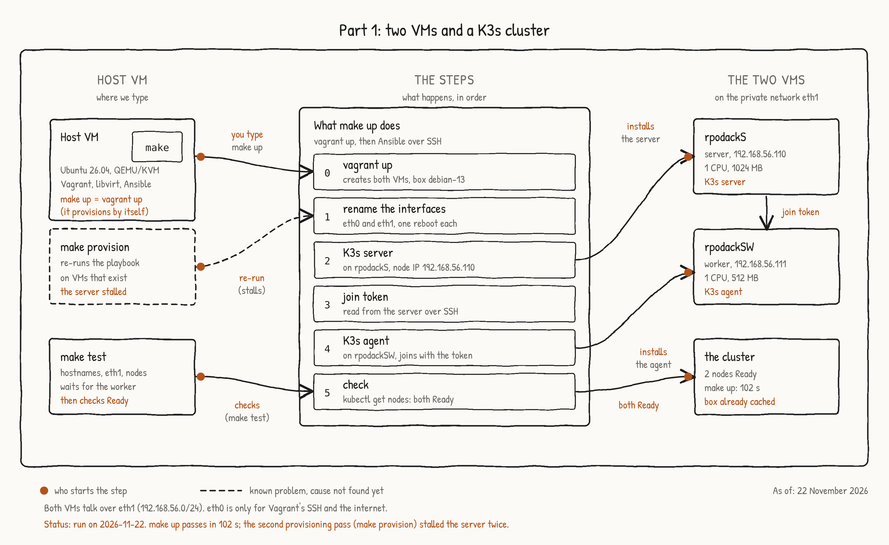
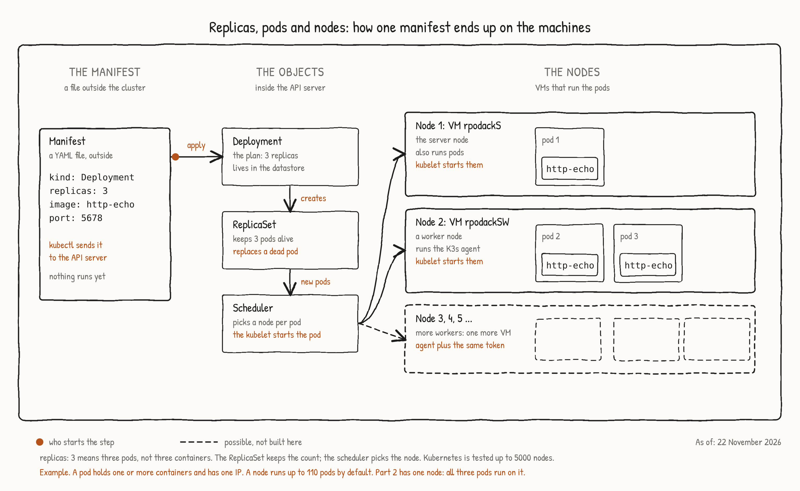

# Sketches

All sketches of the project on one page. The first group are nested boxes: what sits inside what, drawn by us (sources in `docs/lab/nesting`). The other groups are the hand-drawn sketches in `docs/diagrams` on the branch `host-vm-kvm` (pull request 6). State of the drawings: 22 November 2026. A dot marks who opens a connection or starts a step; dashed means written but not run yet. Only Part 1 has been run. Click a picture to open it at full size.

## What sits inside what

Read each picture from the outside in. The small doors are ports; a Service is the dashed address in front of its pods. The limits in the first two are the documented ones for large clusters (kubernetes.io, Considerations for large clusters): 110 pods per node, 5,000 nodes, 150,000 pods in a cluster, at about two containers per pod or fewer. The numbers of pods in the first two are made up.

<figure>

<figcaption>One node at its limit: 110 pods, and the containers inside them. A pod is the unit Kubernetes places; most hold one container, some two. The 111th pod goes to another node, or waits as Pending if no node has room.</figcaption>
</figure>

<figure>

<figcaption>Kubernetes at scale: many nodes, each with up to 110 pods; the squares of one colour are the replicas of one Deployment, spread over the nodes. One pod is zoomed in to show its containers.</figcaption>
</figure>

<figure>

<figcaption>The cluster: three nodes, the control plane with the API server in the server node, replicas spread over the nodes with the Service in front of them.</figcaption>
</figure>

<figure>

<figcaption>Part 1: the computer, the host VM, two VMs, one K3s node in each; the cluster is both nodes together, joined at port 6443.</figcaption>
</figure>

<figure>

<figcaption>Part 2: one VM with one node; port 80 reaches Traefik, which picks one of three Services; app2 has three replica pods.</figcaption>
</figure>

<figure>

<figcaption>Part 3: Docker, the k3d cluster, two node containers, the pods of Argo CD and of the app; GitHub outside.</figcaption>
</figure>

## Final state of each part

<figure>

<figcaption>Part 1 running: the K3s server and the K3s agent in their two VMs, kubectl as the client, the join over port 6443, the pod network on eth1.</figcaption>
</figure>

<figure>

<figcaption>Part 2 running: curl with a Host header, Traefik on port 80, three Services, the pods behind them.</figcaption>
</figure>

<figure>

<figcaption>Part 3 running: Argo CD polling the GitHub repository and keeping the namespace dev equal to it, the app on port 8888, the interface on 8080.</figcaption>
</figure>

<figure>

<figcaption>The finished setup: the four folders that are turned in, where each runs inside the host VM, and what you see once it is up.</figcaption>
</figure>

## Overview of each part

<figure>

<figcaption>Part 1: the host VM, the steps of make up, the two VMs, the known stall of make provision.</figcaption>
</figure>

<figure>

<figcaption>Part 2: the Host header, Traefik, three apps, app3 as the default.</figcaption>
</figure>

<figure>

<figcaption>Part 3: the GitHub repository, Argo CD, the k3d cluster, the push from v1 to v2.</figcaption>
</figure>

<figure>

<figcaption>Replicas: a manifest becomes a Deployment, a ReplicaSet and pods; the scheduler spreads the pods over the nodes; replicas are pods, not containers; more workers join with the same token.</figcaption>
</figure>

