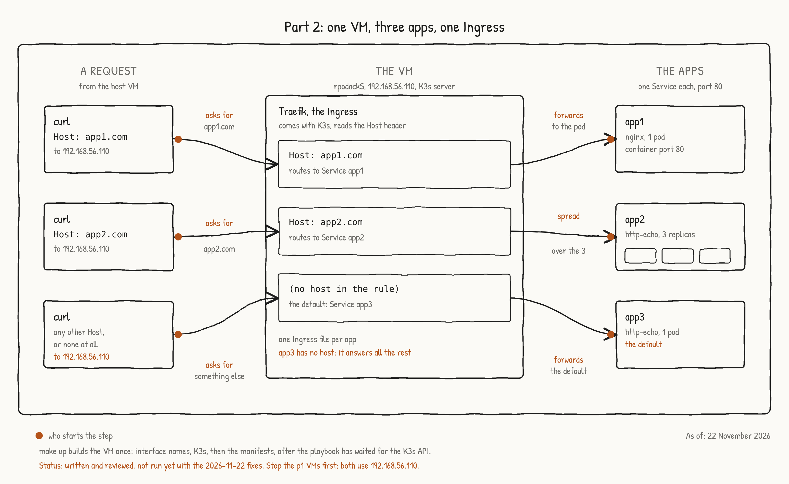

# Sketches

All sketches of the project on one page, one per screen, in the order Part 1, Part 2, Part 3, the bonus, the whole project, and last Kubernetes in general. Click a picture to see it full screen; there the arrows (or the arrow keys) go to the next and the previous one, and Escape closes it. For each part: the hand-drawn final state, then the same part as nested boxes (what sits inside what), then the hand-drawn overview of its steps.

A dot marks who opens a connection or starts a step; dashed means written but not run yet. Only Part 1 has been run. The hand-drawn sketches are in `docs/diagrams` on the branch `host-vm-kvm` (pull request 6); the nested boxes are drawn from `docs/lab/nesting`. Numbers of pods in the Kubernetes pictures are made up where they say so.

## Part 1: K3s and Vagrant

<figure>

<figcaption>Part 1 running: the physical computer at 42, the host VM on it, the two VMs as qemu processes in the host VM, K3s server and agent inside them, kubectl as a client in the server VM, Vagrant and Ansible not running.</figcaption>
</figure>

<figure>

<figcaption>Part 1 nested: the computer, the host VM, two VMs, one K3s node in each; the cluster is both nodes together, joined at port 6443.</figcaption>
</figure>

<figure>

<figcaption>Part 1 overview: the host VM, the steps of make up, the two VMs, the known stall of make provision.</figcaption>
</figure>

## Part 2: K3s and three applications

<figure>

<figcaption>Part 2 final state: curl with a Host header, Traefik on port 80, three Services, the pods behind them.</figcaption>
</figure>

<figure>

<figcaption>Part 2 nested: one VM with one node; port 80 reaches Traefik, which picks one of three Services; app2 has three replica pods.</figcaption>
</figure>

<figure>

<figcaption>Part 2 overview: the Host header, Traefik, three apps, app3 as the default.</figcaption>
</figure>

## Part 3: K3d and Argo CD

<figure>

<figcaption>Part 3 final state: Argo CD polling the GitHub repository and keeping the namespace dev equal to it, the app on port 8888, the interface on 8080.</figcaption>
</figure>

<figure>

<figcaption>Part 3 nested: Docker, the k3d cluster, two node containers, the pods of Argo CD and of the app; GitHub outside.</figcaption>
</figure>

<figure>

<figcaption>Part 3 overview: the GitHub repository, Argo CD, the k3d cluster, the push from v1 to v2.</figcaption>
</figure>

## Bonus: a local GitLab

<figure>

<figcaption>Bonus final state: Part 3 with one change, the repository Argo CD follows is a GitLab inside the cluster; one server node, ports 8929 and 8888.</figcaption>
</figure>

<figure>

<figcaption>Bonus nested: Docker, the k3d cluster bonus, one server node, and in it the pods of GitLab, Argo CD and the app.</figcaption>
</figure>

## The whole project

<figure>

<figcaption>The finished setup: the four folders that are turned in, where each runs inside the host VM, and what you see once it is up.</figcaption>
</figure>

## Kubernetes in general

The nesting reads from the outside in. The limits in the scale pictures are the documented ones for large clusters (kubernetes.io, Considerations for large clusters): 110 pods per node, 5,000 nodes, 150,000 pods in a cluster, at about two containers per pod or fewer.

<figure>

<figcaption>A full Kubernetes architecture with the technologies we use: the control plane, the objects, the nodes with kubelet, kube-proxy, containerd and Flannel, the K3s add-on pods, Argo CD, and the tools outside that build and ask the cluster.</figcaption>
</figure>

<figure>

<figcaption>The cluster: three nodes, the control plane with the API server in the server node, replicas spread over the nodes with the Service in front of them.</figcaption>
</figure>

<figure>

<figcaption>Kubernetes at scale: many nodes, each with up to 110 pods; squares of one colour are the replicas of one Deployment, spread over the nodes. One pod is zoomed in to show its containers.</figcaption>
</figure>

<figure>

<figcaption>One node at its limit: 110 pods, and the containers inside them. The 111th pod goes to another node, or waits as Pending if no node has room.</figcaption>
</figure>

<figure>

<figcaption>Replicas: a manifest becomes a Deployment, a ReplicaSet and pods; the scheduler spreads the pods over the nodes; replicas are pods, not containers.</figcaption>
</figure>

